# Quorum: five-minute demo

**Setup** (before the audience arrives):
- Run `npm run seed && npm start` and open http://127.0.0.1:3000.
- Every account's password is `quorum-demo-2026`. The sign-in page has one-click buttons for the demo accounts.
- Each step below shows a screenshot, captured by `npm run test:e2e` from the same seed.
- Every screen has a matching `-mobile.png` at 390px, so you can resize the window at any point to show the phone layout.

The story: **people decide, the rules hold, and every outcome can be explained.**

---

## 0:00 Sign in (15 s)

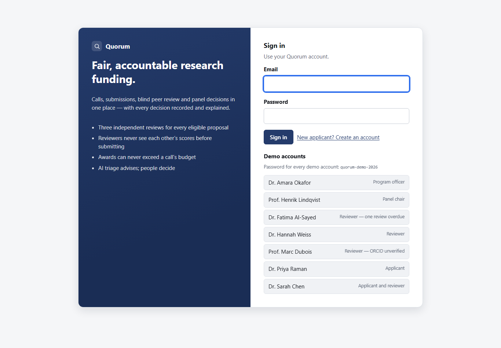

Quorum has four roles, and each person sees only their own role's work. If one account holds two roles (Sarah Chen is both an applicant and a reviewer), it acts in one role at a time (INV-11).

## 0:15 Applicant: submit a proposal (60 s)

Sign in as **Dr. Priya Raman** and open her draft on *Climate Resilience in Northern Communities*.

1. Click **Review and submit…** with the draft still incomplete. The error summary links to each field, and nothing typed is lost.

   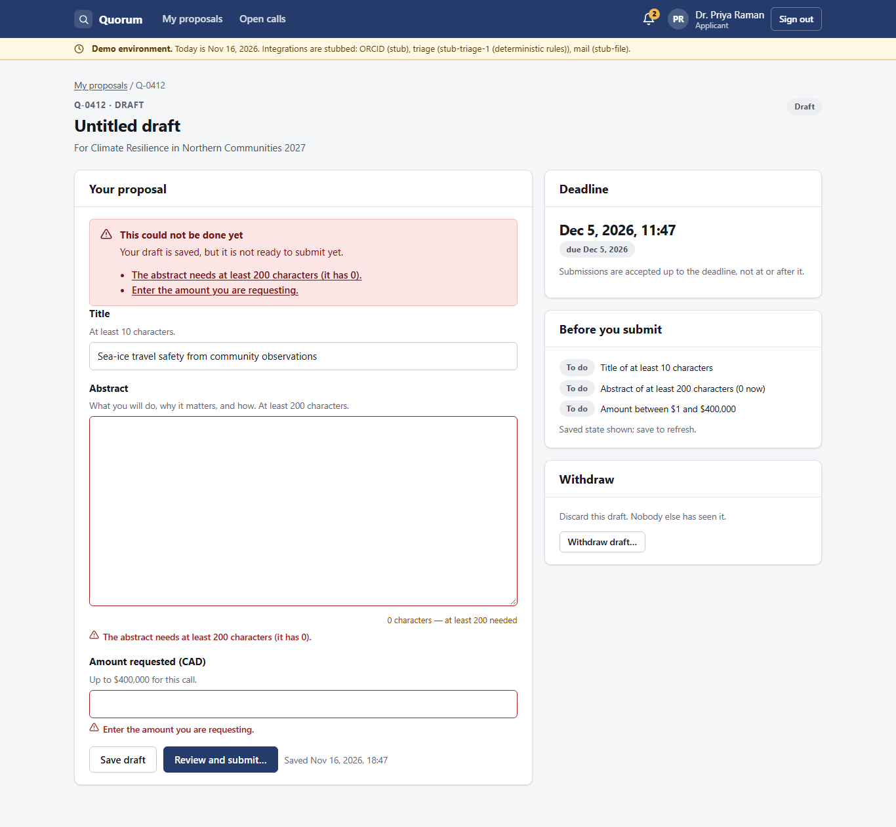
2. Fill in the title, an abstract of at least 200 characters and an amount. Submitting asks for an explicit confirmation, because a submission is final (INV-2) and is accepted only while the call is open (INV-1).

   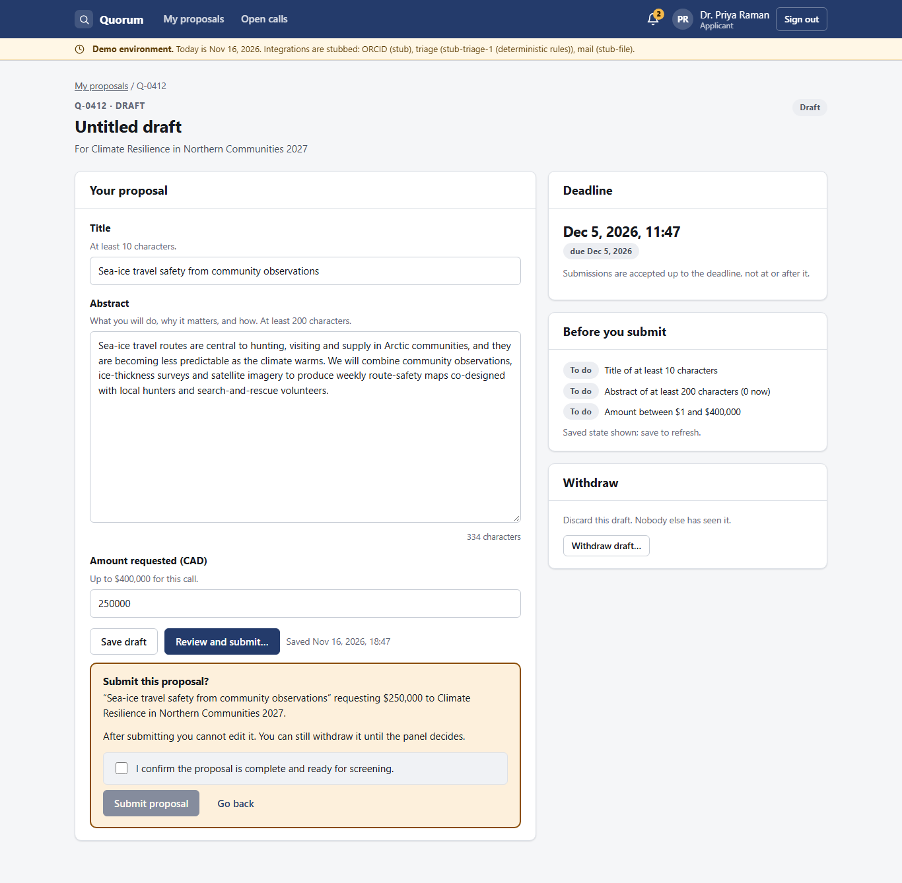
3. The proposal shows a progress stepper. The applicant always knows where it stands.

   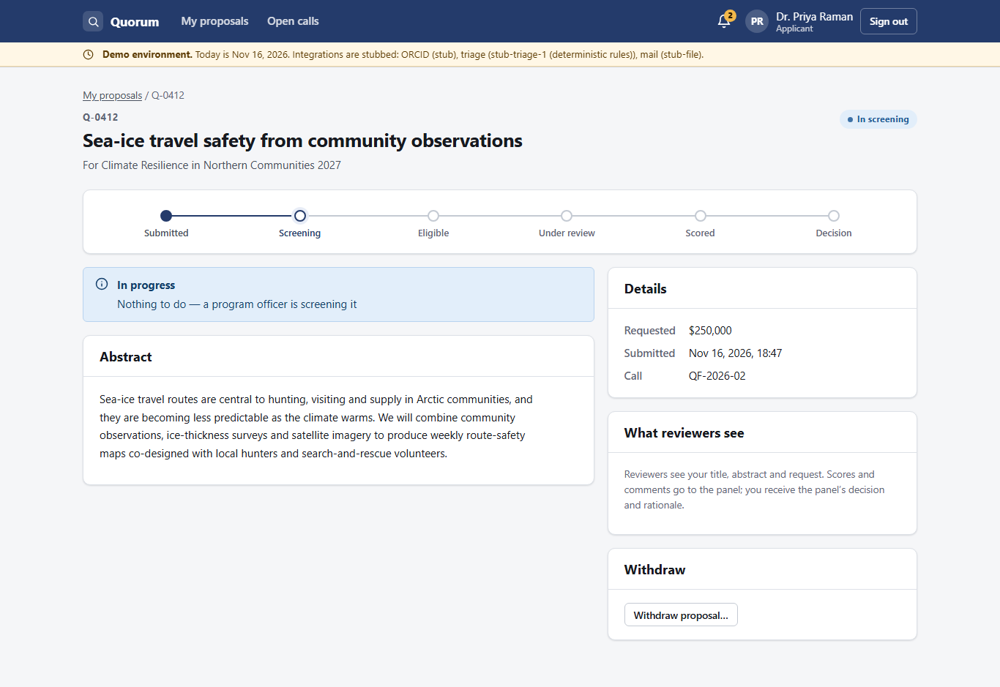

## 1:15 Officer: screening with an advisory agent (45 s)

Sign in as **Dr. Amara Okafor**. The work queue shows the new proposal *In screening*.

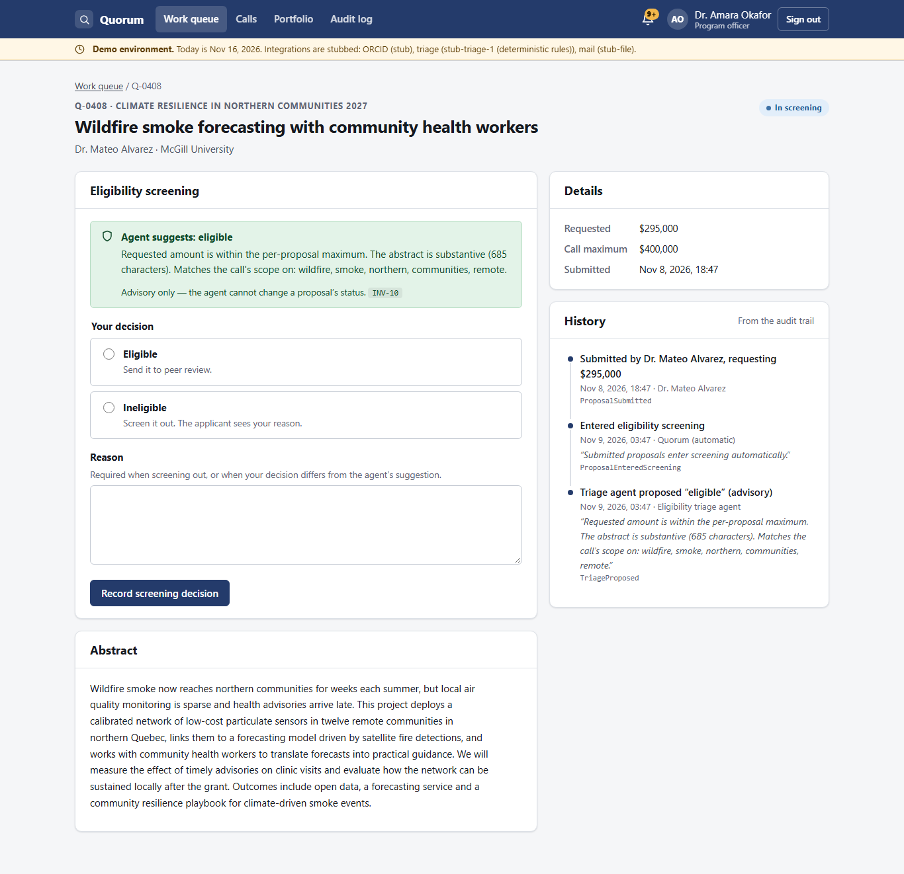

- The triage agent's suggestion is shown, and it is labelled **advisory**.
- The agent cannot change a proposal's status (INV-10). Its account has no role and no command it can send.
- Overriding the agent requires a reason, which goes into the audit trail.

Mark the proposal eligible and assign three reviewers. The candidate list explains each exclusion:
- *Marc Dubois*: ORCID not verified (INV-12).
- The applicant herself: self-review (INV-4).
- Anyone who has declared a conflict (INV-3).

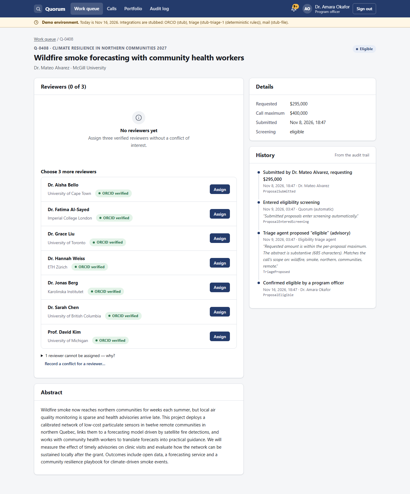

When the third reviewer is assigned, the proposal moves to **Under review**.

## 2:00 Reviewer: blind review (60 s)

Sign in as **Dr. Fatima Al-Sayed** and open her overdue assignment.
1. Submit with one criterion unscored. The review is refused, the field is flagged, and the scores already given are kept (INV-6).

   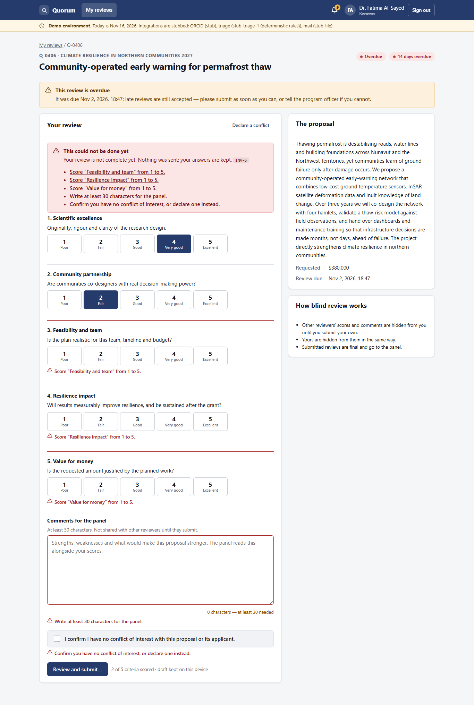
2. Complete it and confirm. Only now do the other reviews become visible, anonymised (INV-7). This is the third review, so the proposal is scored. Quorum never scores a proposal on two reviews (INV-5).

   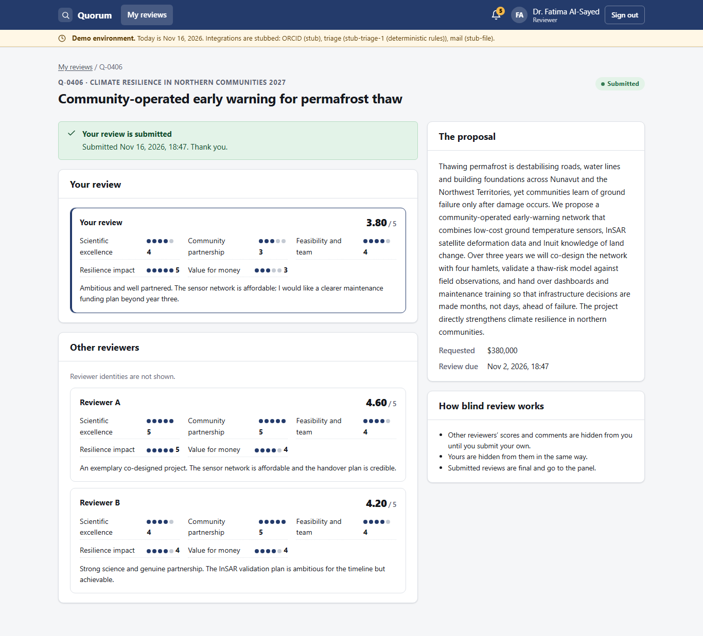

## 3:00 Chair: decisions within the envelope (75 s)

Sign in as **Prof. Henrik Lindqvist**. The decision queue shows each call's budget envelope, how much is committed, and the ranked scored proposals.

1. Award a proposal that fits within the remaining budget. A rationale is required and is sent to the applicant.

   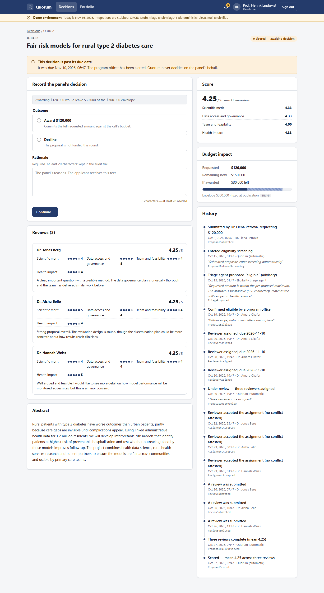
2. Open *wearable atrial fibrillation* ($140,000, with $30,000 left). The budget panel warns that this award would exceed the envelope. Try to award it anyway: Quorum refuses, commits nothing, and **Award** is no longer offered. The only remaining outcome is a decline (INV-9).

   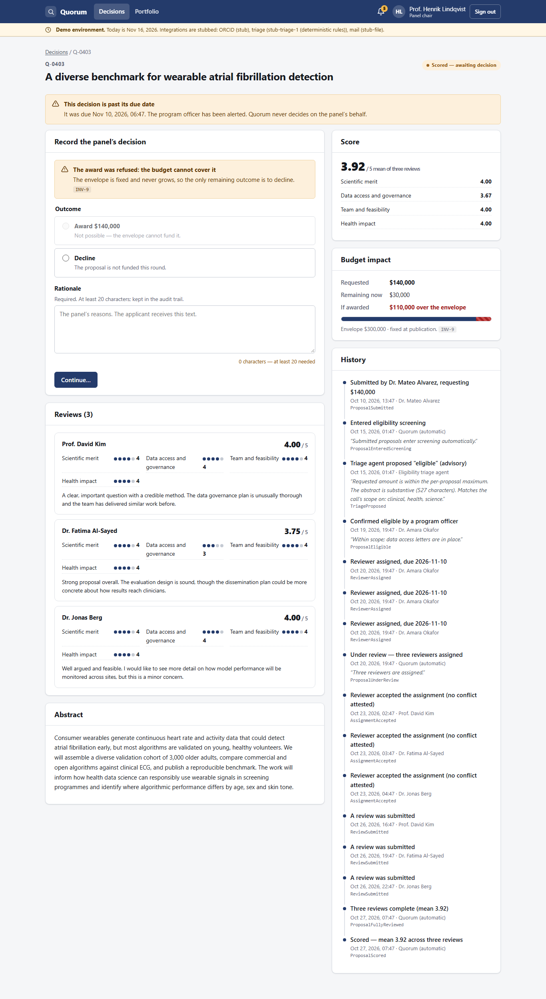

   The budget limit holds under concurrency. A test runs ten processes racing for a $300,000 envelope; exactly seven awards commit.

## 4:15 Oversight: the portfolio and the audit trail (30 s)

Open **Portfolio**, then a proposal's **History**. Every transition records who made it, when and why. This includes the agent's advice, the officer's screening decision and the chair's rationale. The view is projected from events alone, and it can be rebuilt from the event log.

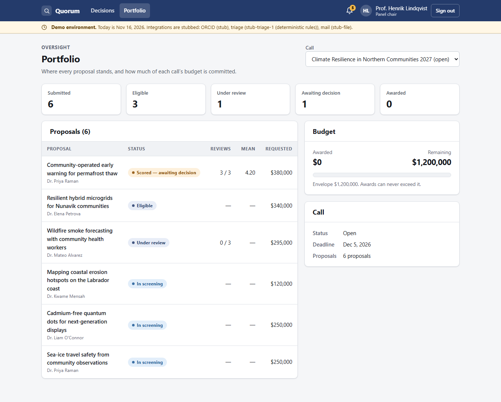

## 4:45 How the architecture is kept (15 s)

Quorum ships its architecture next to its code. `continuum/` holds the business model, the ADL model, technology bindings, 16 proposed decisions and 15 acceptance scenarios that run against this code. To close, show:

```
continuum package run continuum        # 15 passed, 0 failed
continuum conformance check continuum  # CONFORMS
```

The architecture checks catch a deliberate regression, and the release report explains how (`docs/RELEASE_REPORT.md` §4).

---

### If you have extra time

- **Demo clock:** as the officer, use the demo strip to advance time 7 days. Reviews become overdue, and decisions past their due date are flagged; nothing is ever decided automatically. Sessions use wall-clock time, so moving the demo clock doesn't sign anyone out.

  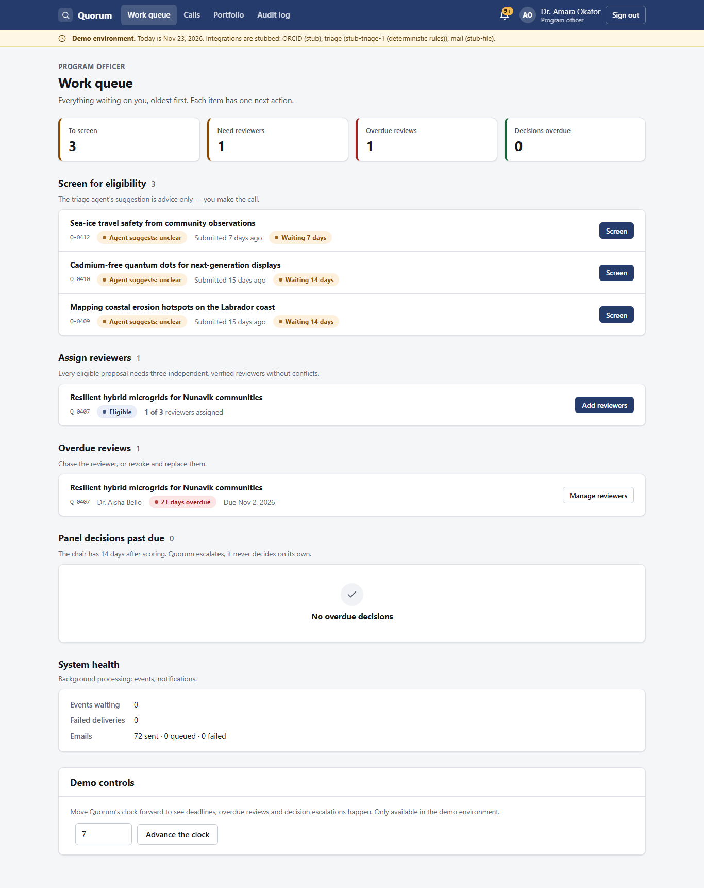
- **Mobile:** every screenshot has a `-mobile.png` twin. On a phone, tables become stacked cards, and the reviewer sees the proposal before the scoring form.
- **Open question for the audience:** what should happen when a reviewer discloses a conflict *after* a proposal is scored? Today the award is held, and only a decline remains. The owner hasn't decided yet (release report §6).
